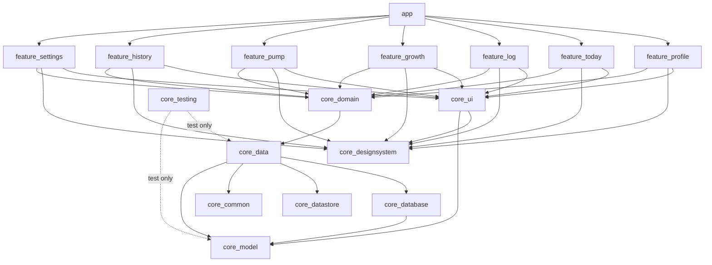

# Baby Status — Architecture Plan

Design source: [Baby Tracker canvas](https://claude.ai/artifact/UEkiiESeSGJnMnkkceZmrg)

| Artboard | Screen |
|---|---|
| `Main.dc.html` | Today |
| `AddActivity.dc.html` | Log activity sheet (Bottle / Solids / Diaper; `editMode` variant) |
| `LogGrowth.dc.html` | Log growth sheet |
| `History.dc.html` | History (day groups, swipe-delete, Undo snackbar) |
| `Onboarding.dc.html` | Onboarding (also reused as Edit profile from Settings) |
| `Settings.dc.html` | Settings |
| `LogPump.dc.html` | Log pumping sheet (Mom; `editMode` variant) |

### Where the plan overrides the mockups
The mockups contain placeholder values. Where they differ from this plan, **the plan wins**:
- Settings has no mock for **Mom's name** (§5 Settings). It's specced here and needs a design pass.
- Wording: Today says "Height" and the growth sheet says "Length". Both are kept as designed, and they refer to the same `length_mm` value.

## 1. Scope (v1)

| Area | Decision |
|---|---|
| Purpose | Real daily use + portfolio. Production-grade, not over-engineered |
| Users / sync | One device, **local only**. Data layer is sync-ready (UUIDs, `updatedAt`, soft deletes) so a backend can be added later without a rewrite |
| Babies | One in the UI. Every row carries `babyId` |
| Feed | **Bottle** (amount only; slider 1–10 oz, default 3) and **Solids** (food + amount + reaction) |
| Diaper | **Pee / Potty** (as designed) |
| Growth | Logged measurements with history, **date only (no time)**. Today shows the latest weight and height. Entered by tapping the stats on Today |
| Units | Stored metric (ml, g, mm). Settings toggle for Imperial/Metric display |
| Photo | Android Photo Picker → copied into app-private storage → Coil |
| Onboarding | One screen: name, birth date, optional photo. The same screen is reused as **Edit profile** from Settings |
| About | Version, an in-app Privacy policy screen, and Send feedback (opens an email draft). Personal install only, not on the Play Store |
| Time entry | Defaults to now; tap to open M3 date + time pickers; no future times, nothing before the birth date |
| History ("See all") | Grouped by day with daily totals; tap to edit in the same sheet; swipe to delete with Undo |
| Theme | Brand theme only (dark forest green + gold); Fraunces + Figtree; no dynamic color |
| Backup | Android Auto Backup (DB + DataStore + photos) |
| Mom: pumping | Log pumping sessions: amount, optional side (Left/Right/Both), optional duration, when, note. Pumping belongs to a **caregiver (Mom)**, not the baby. It's a separate table, and Mom's name is editable in Settings. **No milk stash**: sessions are a log only, not linked to bottle feeds |
| Extras | None in v1 (no reminders, widget or stats) |
| Quality | Unit tests + GitHub Actions CI |
| Platform | minSdk 29, target/compile the latest stable SDK, Kotlin, Compose, Hilt, Navigation 3 |

## 2. Screens & navigation

```
Profile(Create) ──(baby created)──► Today ──► History
                                      │  │         │
                                      │  └► Settings ──► Profile(Edit)
                                      │        │   └───► PrivacyPolicy
                                      │        └───────► mailto: intent (Send feedback)
            (sheet) LogActivity ◄─────┘ ◄── tap an activity row in History (edit)
            (sheet) LogGrowth   ◄── tap Weight/Height on Today, or a growth row in History
            (sheet) LogPump     ◄── tap the Pumping card on Today, or a pump row in History
```

| Nav key | Type | Args |
|---|---|---|
| `ProfileKey` | screen | `mode: Create \| Edit`. Create is the start destination when no baby exists (title "Tell us about your baby", button "Continue"). Edit comes from Settings (back arrow, "Save") |
| `TodayKey` | screen (root) | — |
| `HistoryKey` | screen | — |
| `SettingsKey` | screen | — |
| `PrivacyPolicyKey` | screen | — (static text: "all data stays on this device + Google backup") |
| `LogActivityKey` | bottom sheet | `entryId: String?` (null = new), `initialType: ActivityType?` (Feed or Diaper tile preselects it) |
| `LogGrowthKey` | bottom sheet | `entryId: String?` |
| `LogPumpKey` | bottom sheet | `sessionId: String?` (null = new) |

**Navigation 3 setup (in `:app`)**
- `rememberNavBackStack(...)`. The start key is decided by `MainActivityViewModel` (`Loading` / `NeedsOnboarding` / `Ready`), and the splash screen stays up while the state is `Loading`.
- `NavDisplay` with `entryDecorators = [rememberSaveableStateHolderNavEntryDecorator(), rememberViewModelStoreNavEntryDecorator()]`, so each entry gets its own ViewModel scope.
- A `BottomSheetSceneStrategy` (Nav3 recipe) renders the keys marked as sheets in `ModalBottomSheet`.
- **Feature modules never depend on each other.** Each feature exposes its `NavKey`s and an `EntryProviderScope<NavKey>.xxxEntries(onNavigate… lambdas)` extension. `:app` connects the lambdas to back stack operations.
- ViewModels that take nav args use Hilt assisted injection: `@HiltViewModel(assistedFactory = …)` + `hiltViewModel<VM, VM.Factory> { it.create(key) }`.

## 3. Module graph



| Module | Contents |
|---|---|
| `build-logic/convention` | Plugins: `babystatus.android.application`, `.android.library`, `.android.feature` (library + compose + hilt + core:ui/designsystem/domain), `.android.compose`, `.hilt`, `.android.room`, `.jvm.library` |
| `:app` | `@HiltAndroidApp`, `MainActivity` (edge-to-edge, splash), `NavDisplay`, sheet scene strategy, backup rules |
| `:core:model` | **Pure Kotlin.** `Baby`, `Caregiver`, the `TimelineEntry` hierarchy (`LogEntry` for the baby, `PumpSession` for Mom), value types (`Volume`, `Mass`, `Length`), enums, `UnitSystem`, `UserPreferences` |
| `:core:common` | `@Dispatcher` qualifiers, injectable `java.time.Clock`, `IdGenerator` (UUID) |
| `:core:database` | Room DB, entities, DAOs, converters, exported schemas + migrations |
| `:core:datastore` | Preferences DataStore wrapper (`unitSystem`) |
| `:core:data` | Repository interfaces + implementations (`Baby`, `Log`, `Pump`, `Caregiver`, `Timeline`, `UserPreferences`), `PhotoStore` (copy/downscale/delete) |
| `:core:domain` | Use cases that combine repositories or hold rules: `GetTodayStatusUseCase`, `CalculateAgeUseCase`, `ValidateLogEntryUseCase`, `GetHistoryUseCase` |
| `:core:designsystem` | `BabyStatusTheme` (colors, bundled Fraunces/Figtree fonts, shapes), stateless components: `ActivityTile`, `StatLabel`, `BabyAvatar`, `SelectableTile`, `LogFab`, `PrimaryButton`, icons |
| `:core:ui` | UI that knows the model: `LogEntryRow`, `UnitFormatter`, `RelativeTimeFormatter`, `DateTimeField` (picker dialogs) |
| `:core:testing` | Fake repositories, `MainDispatcherRule`, test data builders |
| `:feature:profile` | Profile screen + VM, in Create mode (onboarding) or Edit mode (from Settings) |
| `:feature:today` | Today screen + VM |
| `:feature:log` | Log activity sheet (Bottle / Solids / Diaper; create + edit + delete) |
| `:feature:growth` | Log growth sheet (create + edit + delete) |
| `:feature:pump` | Log pumping sheet (create + edit + delete) |
| `:feature:history` | Paged list grouped by day, swipe to delete + Undo |
| `:feature:settings` | Settings (profile card → Profile(Edit), units toggle, About) + Privacy policy screen |

## 4. Data layer

### 4.1 Domain model (`:core:model`)

```kotlin
data class Baby(val id: String, val name: String, val birthDate: LocalDate, val photoPath: String?)

/** Anything that shows on the History timeline. */
sealed interface TimelineEntry { val id: String; val date: LocalDate; val note: String? }

/** The baby's entries (log_entry table). */
sealed interface LogEntry : TimelineEntry
sealed interface TimedEntry : LogEntry { val occurredAt: Instant }       // date = occurredAt in local zone
data class Bottle(..., val volume: Volume) : TimedEntry
data class Solids(..., val food: String, val amount: SolidsAmount, val reaction: Reaction?) : TimedEntry
data class Diaper(..., val kind: DiaperKind) : TimedEntry
data class Growth(..., val weight: Mass?, val length: Length?) : LogEntry  // date only; at least one of weight/length

/** Mom's entries (pump_session table). Not a LogEntry: it isn't about the baby. */
data class Caregiver(val id: String, val role: CaregiverRole, val name: String)
enum class CaregiverRole { MOTHER }
data class PumpSession(              // no caregiverId: the data layer attaches Mom, as it does the baby
    override val id: String, val occurredAt: Instant, override val date: LocalDate,
    override val note: String?, val volume: Volume, val side: BreastSide?, val duration: Duration?,
) : TimelineEntry
enum class BreastSide { LEFT, RIGHT, BOTH }
enum class ActivityType { FEED, DIAPER }
enum class SolidsAmount { TASTE, SOME, LOTS }
enum class Reaction { LIKED, DISLIKED, ALLERGIC }
enum class DiaperKind { PEE, POTTY }
enum class UnitSystem { IMPERIAL, METRIC }

@JvmInline value class Volume(val ml: Double)   // oz = ml / 29.5735
@JvmInline value class Mass(val grams: Int)
@JvmInline value class Length(val mm: Int)
```

### 4.2 Room schema (`:core:database`)

The baby's entries share one `log_entry` table with a type discriminator, so "last feed/diaper" and "latest growth" stay simple indexed queries. Mom's pumping lives in its own `pump_session` table, owned by a `caregiver`. History merges the two with one `UNION ALL` (§4.2.1).

**`baby`**: `id TEXT PK`, `name`, `birth_epoch_day INTEGER`, `photo_path TEXT?`, `created_at`, `updated_at`, `deleted_at?`

**`log_entry`**

| Column | Type | Notes |
|---|---|---|
| `id` | TEXT PK | UUID, generated on the device (sync-safe) |
| `baby_id` | TEXT FK → baby | indexed |
| `type` | TEXT | `BOTTLE` / `SOLIDS` / `DIAPER` / `GROWTH` |
| `occurred_at` | INTEGER? | epoch millis UTC. **NULL for GROWTH** (date only) |
| `local_epoch_day` | INTEGER | local day at write time, used for grouping and daily totals without timezone math in SQL. For GROWTH it is the chosen date |
| `note` | TEXT? | |
| `volume_ml` | REAL? | BOTTLE |
| `food`, `solids_amount`, `reaction` | TEXT? | SOLIDS |
| `diaper_kind` | TEXT? | DIAPER |
| `weight_g`, `length_mm` | INTEGER? | GROWTH |
| `created_at`, `updated_at` | INTEGER | |
| `deleted_at` | INTEGER? | soft delete: powers Undo now, becomes a sync tombstone later |

Indexes: `(baby_id, deleted_at, local_epoch_day DESC, occurred_at DESC)`, `(baby_id, type, occurred_at DESC)`.

**`caregiver`** (schema v2): `id TEXT PK`, `role TEXT` (`MOTHER`), `name TEXT` (default "Mom"), `created_at`, `updated_at`, `deleted_at?`. Household-level, with no `baby_id`: with twins, one mother pumps for both. Only the pumping owner for now; a "logged by" link on every entry waits for sync and accounts.

**`pump_session`** (schema v2)

| Column | Type | Notes |
|---|---|---|
| `id` | TEXT PK | UUID |
| `caregiver_id` | TEXT FK → caregiver | indexed |
| `occurred_at` | INTEGER | epoch millis UTC (always timed) |
| `local_epoch_day` | INTEGER | same role as in `log_entry` |
| `volume_ml` | REAL | required |
| `side` | TEXT? | `LEFT` / `RIGHT` / `BOTH` |
| `duration_min` | INTEGER? | 1–180 |
| `note` | TEXT? | |
| `created_at`, `updated_at`, `deleted_at?` | INTEGER | same sync-ready conventions |

Index: `(caregiver_id, deleted_at, local_epoch_day DESC, occurred_at DESC)`.

**Migration 1 → 2** only creates the two tables, so it's a Room `AutoMigration(from = 1, to = 2)` generated from the committed `1.json` / `2.json` schemas. The Mom row is created lazily by `CaregiverRepository.mother()` (get-or-insert, in a transaction). That one code path covers fresh installs, upgrades and restored backups, and nothing extra is needed at onboarding.

#### 4.2.1 The merged timeline

`TimelineDao.pagingSource(babyId)` is a raw `@Query` returning `TimelineRow`, a POJO with the union of both tables' columns plus `source` (`'LOG'` / `'PUMP'`):

```sql
SELECT 'LOG' AS source, id, type, occurred_at, local_epoch_day, created_at, note, volume_ml, food, …, NULL AS side, NULL AS duration_min
  FROM log_entry WHERE baby_id = :babyId AND deleted_at IS NULL
UNION ALL
SELECT 'PUMP', id, 'PUMP', occurred_at, local_epoch_day, created_at, note, volume_ml, NULL, …, side, duration_min
  FROM pump_session WHERE deleted_at IS NULL
ORDER BY local_epoch_day DESC, occurred_at IS NULL DESC, occurred_at DESC, created_at DESC
```

Room's `PagingSource` for a multi-table query observes both tables, so any write to either invalidates History. `observeDailyTotals` is a second grouped `UNION ALL` that adds `pumped_ml` next to bottle ml and the pee/potty counts. Malformed rows of either kind are skipped by the mapper, as today.

**Timeline order** (History and anything mixing types): `ORDER BY local_epoch_day DESC, occurred_at IS NULL DESC, occurred_at DESC, created_at DESC`. Growth rows (NULL time) sort to the top of their day.

Key DAO queries (all return `Flow` unless noted):
- `observeLatest(babyId, types, limit)`: today's recent list and last feed/diaper
- `observeLatestWeight(babyId)` / `observeLatestLength(babyId)`: the most recent non-null value of each by `local_epoch_day DESC, updated_at DESC`. They may come from different measurements
- `pagingSource(babyId)`: `PagingSource<Int, LogEntryEntity>` for History, in timeline order
- `observeDailyTotals(babyId)` (now on `TimelineDao`): `GROUP BY local_epoch_day` over the union → bottle ml, **pumped ml**, pee count, potty count (header: "18 oz fed · 14 oz pumped · 4 pee · 2 potty"; solids and growth aren't totalled)
- `PumpDao`: `observeTotalOn(day)` (sum ml), `observeLatest()`, `getById`, `upsert`, `softDelete`, `restore`
- `observeFoodSuggestions(babyId, prefix)`: `SELECT food … GROUP BY food ORDER BY MAX(occurred_at) DESC` (most recently eaten first), merged in the repository with a built-in starter list (Banana, Sweet potato, Avocado, Rice cereal, Peas, Applesauce) so suggestions appear before any solids have been logged
- `upsert`, `softDelete(id, now)`, `restore(id)`

Mapping entity ↔ `LogEntry` happens in `:core:data`. A malformed row (for example BOTTLE with a null volume) is logged and skipped, never allowed to crash the app.

### 4.3 Repositories (`:core:data`)

```kotlin
interface BabyRepository { fun observeBaby(): Flow<Baby?>; suspend fun create(...); suspend fun update(baby: Baby) }
interface LogRepository {
    fun observeRecent(limit: Int): Flow<List<LogEntry>>
    fun observeLast(type: ActivityType): Flow<TimedEntry?>
    fun observeLatestGrowth(): Flow<LatestGrowth>
    fun foodSuggestions(prefix: String): Flow<List<String>>
    suspend fun get(id: String): LogEntry?
    suspend fun save(entry: LogEntry)          // upsert, stamps updatedAt
}
interface PumpRepository {
    fun observeSummary(today: LocalDate): Flow<PumpSummary>   // total pumped today + last session
    suspend fun get(id: String): PumpSession?
    suspend fun save(session: PumpSession)
}
interface CaregiverRepository {
    fun observeMother(): Flow<Caregiver>                       // emits the default "Mom" until the row exists
    suspend fun mother(): Caregiver                            // get-or-create
    suspend fun rename(id: String, name: String)
}
/** History and delete/undo span both tables. */
interface TimelineRepository {
    fun history(): Flow<PagingData<TimelineEntry>>
    fun observeDailyTotals(): Flow<Map<LocalDate, DailyTotals>>   // DailyTotals gains `pumped: Volume`
    suspend fun delete(id: String)                             // soft; routes by which table holds the id
    suspend fun undoDelete(id: String)
}
interface UserPreferencesRepository { val preferences: Flow<UserPreferences>; suspend fun setUnitSystem(u: UnitSystem) }
interface PhotoStore { suspend fun importFromPicker(uri: Uri): String /* relative path */; suspend fun delete(path: String) }
```

`babyId` resolution stays inside the repositories ("the single baby"), so the UI never passes it around. Supporting several babies later becomes a repository change plus a `activeBabyId` preference.

### 4.4 Units

- Always stored metric. The conversion happens once, in `UnitFormatter` (display) and in the slider state (input).
- Bottle **and pump** sliders share one `VolumeScale` (formerly `BottleScale`): Imperial 1–10 oz in 0.5 steps, default 3 oz. Metric 30–300 ml in 10 ml steps, default 90 ml. When editing, the stored value snaps to the nearest step.
- Display: weight `13.2 lb` / `6.0 kg`; length `23.5 in` / `59.7 cm`; volume `3 oz` / `90 ml`.

### 4.5 Photos

`PickVisualMedia(ImageOnly)` → `PhotoStore` decodes with `ImageDecoder`, downsizes to ≤1024 px, writes `filesDir/photos/<uuid>.jpg`, updates `baby.photoPath` and deletes the previous file. No runtime permissions needed.

## 5. UI layer pattern

Every screen follows the same structure:

```
XxxRoute(viewModel)  ── collectAsStateWithLifecycle ──►  XxxScreen(uiState, onAction)   // stateless, previewable
XxxViewModel: StateFlow<XxxUiState> (stateIn WhileSubscribed(5s)), fun onAction(XxxAction)
One-off events (e.g. "saved → dismiss", "deleted → show Undo") exposed as state flags consumed by the UI, not Channels.
```

### Today
- `TodayUiState.Loading | Ready(name, dateLabel, photoPath, age, weight?, length?, lastFeed: RelativeTime?, lastDiaper: RelativeTime?, recent: List<LogEntryUi>)`
- Combines baby, latest growth, last feed, last diaper, recent entries, unit preference and a **per-minute ticker** (`flow { while(true) { emit(clock.instant()); delay(untilNextMinute) } }`) so "2h 25m ago" stays current.
- Both tiles show relative time ("2h 25m ago"). The design mixed relative and clock time.
- The recent list shows the 5 most recent entries from today, with an empty state when there are none.
- **Pumping card** (under the Feed/Diaper tiles): pump icon on `#F6E1DA`, "Pumping" + a **MOM** badge, subtitle "14 oz today · last 3h ago" ("Nothing today · last 1d ago" / "Not logged yet"), and a rust `#8E4436` "+ Log" pill. The whole card is one button → `LogPumpKey()`. Data: `PumpRepository.observeSummary(today)` combined in `TodayViewModel` (it's Mom's, so it stays out of `GetTodayStatusUseCase`).
- The **Recent list stays baby-only**: pumps don't appear there. History shows them.
- Layout per the new mock: photo 150 dp (was 168) and the status block 284 dp tall, so the extra card fits without scrolling on a 390×844 screen.
- Age comes from `CalculateAgeUseCase`: under 4 weeks `"12 days"`, under 24 months `"3 mo, 1 wk"`, after that `"2 yr, 3 mo"`.

### Log activity sheet
- Form state: `type (FEED|DIAPER)`, `feedKind (BOTTLE|SOLIDS)`, `bottle: Volume`, `food`, `solidsAmount`, `reaction?`, `diaperKind`, `occurredAt`, `note`, `mode (New|Edit)`.
- Feed shows a Bottle | Solids segmented control. Solids shows:
  - a food text field with suggestions
  - required Taste / Some / Lots chips with nothing preselected, so Save stays disabled until one is picked
  - optional Liked / Disliked / Allergic reaction chips; tapping the selected chip clears it
- Save button text: "Save feed" / "Save diaper change".
- Edit mode changes the title to "Edit activity", adds a "Delete entry" text button under Save, and keeps the type locked. Deleting closes the sheet and the underlying screen shows the Undo snackbar.
- `ValidateLogEntryUseCase`: Solids needs a food and an amount; time can't be in the future or before the birth date.

### Log growth sheet
- Date (date picker only), Weight and Length fields in the current unit (lb/in or kg/cm), a hint box ("Enter weight, length, or both"), an optional note, and "Save growth".
- At least one measurement is required. The date can't be in the future or before the birth date.
- Edit mode follows the activity sheet: the title becomes "Edit growth" and a "Delete entry" button appears. (The mockup has no edit variant, so this mirrors AddActivity.)

### Log pumping sheet (`:feature:pump`)
- Header: a small **MOM** badge (`#F6E1DA` / `#7A2F22`) above the title "Log pumping" / "Edit pumping", and the close button.
- "Amount pumped": the same slider card as the bottle (`VolumeScale`, rust `#8E4436` accent), default 3 oz / 90 ml.
- "Side (optional)": Left / Right / Both option buttons (rust accent); tapping the selected one clears it.
- Two columns: "Duration (optional)" (number field, "min" suffix, 1–180) and "When" (date + time picker, **no future time and no birth-date lower bound**, since mothers may pump before the birth).
- Note (placeholder "Froze 2 oz"), "Save pumping", and "Delete entry" in edit mode. Delete goes through the shared Undo snackbar.
- `LogPumpViewModel` resolves `CaregiverRepository.mother()` on save, so the first-ever save creates the Mom row.
- New design tokens: an `Accent` `mom` (`#7A2F22` fg / `#F6E1DA` bg / `#8E4436` border), `momIcon` `#9A4535`, and a `Pump` stroke icon from the mock. A small shared `MomBadge` component goes in `:core:designsystem`.

### History
- A top bar with a back arrow and a light background (`#EEF5EC`). Each day group is a header plus one white rounded card of rows.
- `Pager` → `PagingData<TimelineEntry>` (from `TimelineRepository`) → `insertSeparators` day headers (`Today`, `Yesterday`, `Mon, Sep 22`). Totals now sit on a **second line under the day title** (new mock): "18 oz fed · 14 oz pumped · 4 pee · 2 potty" in current units. "· N oz pumped" is left out on days with no pumping.

| Entry | Icon (circle bg / fg) | Title | Subtitle | Time |
|---|---|---|---|---|
| Bottle | bottle, gold `#F7E9B8` | Feed · Bottle | `5 oz` | `1:40p` |
| Solids | bowl, `#F0E4B8` | Solids · Sweet potato | `Some · Liked it` | `12:30p` |
| Diaper | drop, green `#D9ECD9` | Diaper · Pee / Potty | — | `2:05p` |
| Growth | trend, dark `#1B4332` | Growth | `13.2 lb · 23.5 in` (or just one) | *(none)* |
| Pump | pump, rust `#F6E1DA` / `#9A4535` | Pump + **MOM** badge | `4 oz · Both · 15 min` (missing parts left out) | `1:10p` |

- `SwipeToDismissBox` (end-to-start, red `#8B3A2E` "Delete" background) → soft delete → snackbar "Entry deleted" + **UNDO** → `undoDelete`.
- Tapping a row opens LogActivity, LogGrowth or LogPump in edit mode. Swipe-delete and Undo go through `TimelineRepository`, so pumps behave the same.

### Settings
- A profile card (avatar, name, "Born Jun 12, 2026", chevron) → `ProfileKey(Edit)`.
- **Mom's name** (no mock yet): a white card row under the baby's profile card with the pump icon, "Mom" as the title, the caregiver's name as the subtitle, and a chevron. Tapping it opens an M3 dialog with one text field (1–40 chars) → `CaregiverRepository.rename`. The badge on Today/History/sheet stays the fixed word **MOM**; the name is for Settings and future sync.
- Units: an Imperial | Metric segmented toggle, with the helper text "Imperial shows oz, lb and in · Metric shows ml, kg and cm".
- About: Version (from `BuildConfig.VERSION_NAME`), Privacy policy → `PrivacyPolicyKey` (in-app text), Send feedback → `Intent(ACTION_SENDTO, "mailto:")` with the subject "Baby Status feedback (v1.0.0)" and the address from `BuildConfig.FEEDBACK_EMAIL`.

### Profile (onboarding / edit)
- A green header band ("Welcome" / "Tell us about your baby"), a photo button overlapping the band (dashed gold circle; shows the photo once one is chosen), the name field, and a birth date field (tapping it opens the M3 DatePicker; future dates blocked).
- Create mode: "Continue" is enabled when the name isn't blank and a birth date is set. It creates the baby, then **replaces** the back stack with `[TodayKey]`.
- Edit mode: a back arrow, "Save" instead of Continue, and the fields are prefilled.

## 6. Cross-cutting

| Concern | Approach |
|---|---|
| DI | Hilt. `@Binds` repository interfaces in `:core:data`, DB/DAO providers in `:core:database`, `Clock` + dispatchers in `:core:common` |
| Time | `java.time` (native at minSdk 29). `Clock` is injected everywhere, so tests control "now" |
| Threading | Room/DataStore are main-safe. `PhotoStore` runs on the `@Dispatcher(IO)` dispatcher |
| Edge-to-edge | Required at target SDK 35+. Insets are handled per screen, and the status bar sits over the dark green |
| Fonts | Fraunces + Figtree TTFs bundled in `:core:designsystem/res/font` (OFL), not downloaded, so there's no GMS dependency |
| Backup | `android:fullBackupContent` (API 29–30) + `android:dataExtractionRules` (31+) including `database/`, `datastore/`, `files/photos/` |
| Permissions | None |
| Build | Version catalog `gradle/libs.versions.toml`, KSP for Room and Hilt, Compose BOM, convention plugins |
| Libraries | Compose + Material3, Navigation 3 (+ lifecycle-viewmodel-navigation3), Hilt, Room, Paging 3, DataStore, Coil 3, kotlinx-serialization (NavKeys), core-splashscreen |

## 7. Testing & CI

- **Unit tests (JVM)** with JUnit, `kotlinx-coroutines-test`, Turbine and fakes from `:core:testing`:
  - Every ViewModel (state mapping, validation, save/delete/undo flows)
  - Use cases (`CalculateAgeUseCase` edge cases: leap years, month ends; `ValidateLogEntryUseCase`)
  - `UnitFormatter`/conversions (round-trip snapping), `RelativeTimeFormatter`
  - Entity ↔ model mappers, including malformed rows
- Room schema JSON is exported and committed, so migrations stay reviewable (migration tests can come later).
- **GitHub Actions** (`.github/workflows/ci.yml`) on each PR and push to `main`: `./gradlew assembleDebug lintDebug testDebugUnitTest`, Gradle cache, JDK 21. Reports are uploaded when it fails.

## 8. Path to sync (not v1, design is ready)

1. Add `:core:network` (Firestore or Supabase) + `:sync` with a WorkManager `SyncWorker`.
2. Migration: add a `sync_state`/`server_version` column. Rows already have UUIDs, `updatedAt` and `deletedAt` tombstones.
3. Repositories become offline-first: write locally, mark dirty, push/pull deltas, resolve conflicts with last-write-wins on `updatedAt`.
4. Add auth + a family/household concept. `babyId` scoping already exists.

## 9. Build order

| Milestone | Deliverable |
|---|---|
| (status) | **M0–M5 built** and exercised on an emulator (Sep 24, 2026). **M7 built** (Sep 26, 2026): the upgrade from schema 1 was run on the emulator over real v1 data. M6 polish is partly done; what's left is listed in §11 |
| M0 | Gradle skeleton, build-logic, version catalog, empty modules, theme + fonts, CI green |
| M1 | `:core:model/database/datastore/data/domain` + tests; Profile (Create) end-to-end |
| M2 | Today screen (live data, ticker, age) + Log activity sheet (Bottle / Solids / Diaper) |
| M3 | Growth sheet + latest stats on Today |
| M4 | History (paging, day headers, totals, edit, swipe-delete + Undo) |
| M5 | Settings (units, About, privacy screen, feedback intent) + Profile (Edit) + photo + Auto Backup rules |
| M7 | **Pumping**: schema v2 + migration test, `caregiver`/`pump_session`, `TimelineDao` union, `TimelineRepository` (history, totals, delete/undo move here), `:feature:pump` sheet, Today card, History rows/totals, Settings Mom's name, privacy text mentions pumping |
| M6 | Polish: empty states, accessibility (TalkBack labels, 48dp targets), app icon, release build config |

## 10. Defaults chosen (override if wrong)

- Package / applicationId: `com.sagar.babystatus`; app name **"Baby Status"**.
- Feed/Diaper tiles on Today open the sheet preselected to that type; the FAB opens it on Feed.
- The Recent list shows only today's entries (max 5); "See all" shows everything.
- Deleted entries are kept as tombstones and never hard-deleted (small data, and sync needs them).
- The bottle slider always defaults to 3 oz / 90 ml, not the last amount logged.
- History has no filtering in v1.
- `FEEDBACK_EMAIL` is a `buildConfigField` read from `local.properties` (not committed), so no address is hard-coded in the repo.
- Solids amount is required and has no default. Reaction is optional.
- Pumping: amount required (default 3 oz / 90 ml); side and duration optional; no birth-date lower bound on the time.
- History totals leave out "oz pumped" on days with no pumping.
- The "Log activity" FAB and sheet don't include pumping; the Today card is the way in.
- Pump rows use the History title "Pump" (as mocked) while the card and sheet say "Pumping".

## 11. As built: notes and deviations

Toolchain: Gradle 9.7.1, AGP 9.4.1 (built-in Kotlin, new DSL), Kotlin 2.4.20, KSP 2.3.12, Hilt 2.60.1, Room 2.8.5, Compose BOM 2026.09.00 (Material 3 1.4), Navigation 3 1.2.0, lifecycle 2.11. compileSdk/targetSdk 37, minSdk 29.

Where the code differs from sections 3–5:

- **No `GetHistoryUseCase`.** History's ViewModel reads `LogRepository.history()` and `observeDailyTotals()` directly; a use case would only have forwarded them.
- **`DeleteLogEntryUseCase`** (a `@Singleton`; with M7 it becomes `DeleteEntryUseCase` on top of `TimelineRepository`) soft-deletes and emits the id. `:app` collects it and shows the single "Entry deleted · UNDO" snackbar, so a History swipe and the sheets' "Delete entry" share one Undo path.
- **Food suggestions** are filtered in the ViewModel (`LogActivityViewModel.suggestions`): past foods (most recent first), then the starter list, matching the typed text and never the exact text. The DAO query just returns distinct foods.
- **Today's Recent list** shows timed entries only (growth has no time); tapping a row opens it for editing, as in History.
- **Sheets' `onDone` passes its key back** so `:app` pops only if that sheet is still on top (Save and Close can both fire). Every Back is guarded so the root is never popped.
- **The sheet scene** passes `ModalBottomSheetProperties` for light status-bar icons over the scrim, pads the sheet below the status bar, and implements `equals`/`hashCode` (NavDisplay compares scenes).
- **The History swipe state** uses plain `remember`, not `rememberSwipeToDismissBoxState` (which is saveable). LazyColumn restores saved item state by key, so an undone row came back already dismissed and was deleted again.
- **Dates** use `instant.atZone(zone).toLocalDate()`: `LocalDate.ofInstant` needs API 34 and lint (NewApi) flags it at minSdk 29.

M7 (pumping) as built:
- **`VolumeSliderCard`** moved to `:core:ui`, and the bottle and pump sheets share it with their own accent.
- **Delete/undo** routes by trying `log_entry` first, then `pump_session`. The DAOs' soft-delete queries return the row count, and ids are UUIDs, so only one table can match.
- **The Mom row** is created by `CaregiverDao.getOrCreateMother` (`@Transaction`) on the first pump save or rename. Until then `CaregiverRepository.mother` emits a default "Mom".
- **`PumpSession` has no caregiver id** in the model. `DefaultPumpRepository` attaches the mother on save, like `babyId` for the baby's entries.
- **Pumping card copy:** "Just now" reads as "last just now" on the card, since it's lowercased after "last". This is a copy nit to fix if it bothers anyone.

Still open (M6 + M7):
- An automated migration test (`MigrationTestHelper`). It needs instrumented or Robolectric tests, which v1 skipped. The 1 → 2 upgrade was verified by installing over a v1 build on the emulator.
- Instrumented/UI tests and screenshot tests (out of v1 scope by choice).
- A release signing config. `assembleRelease` builds a minified, unsigned APK today.
- A11y pass with TalkBack on a device (semantics are in place: headings, roles, custom delete action, labels).
